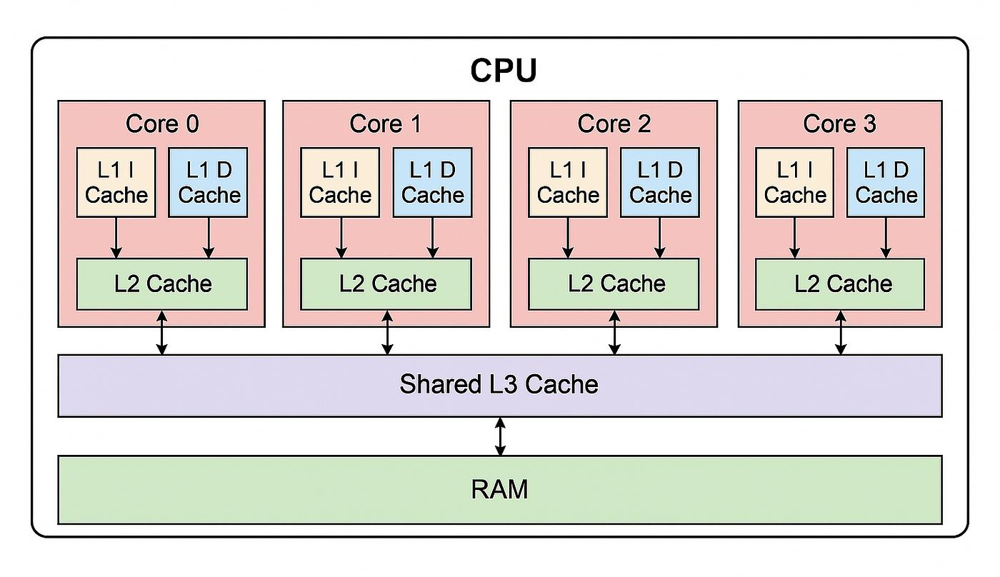
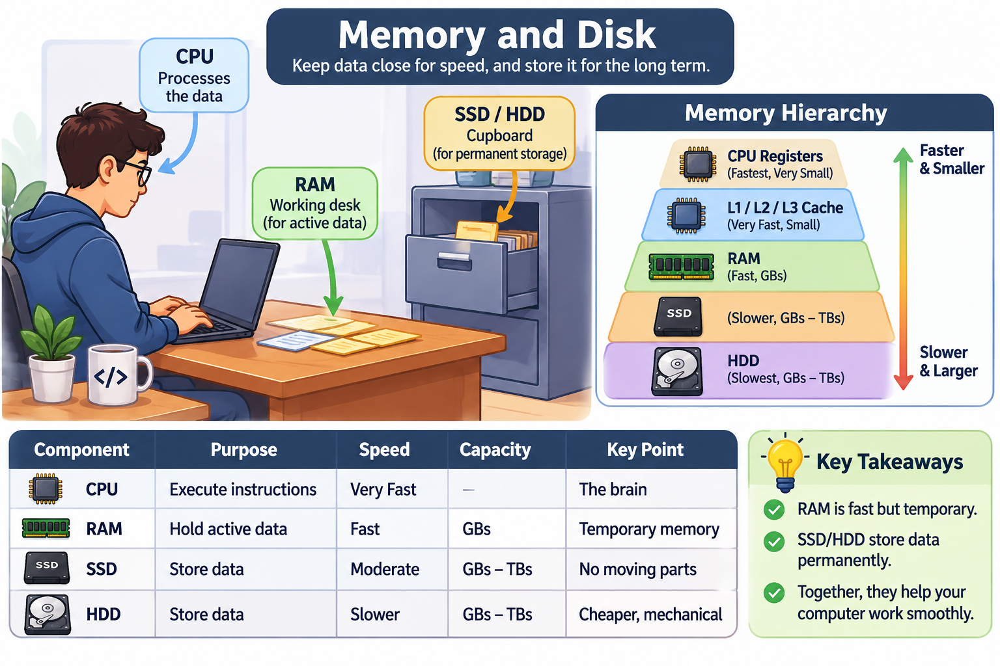
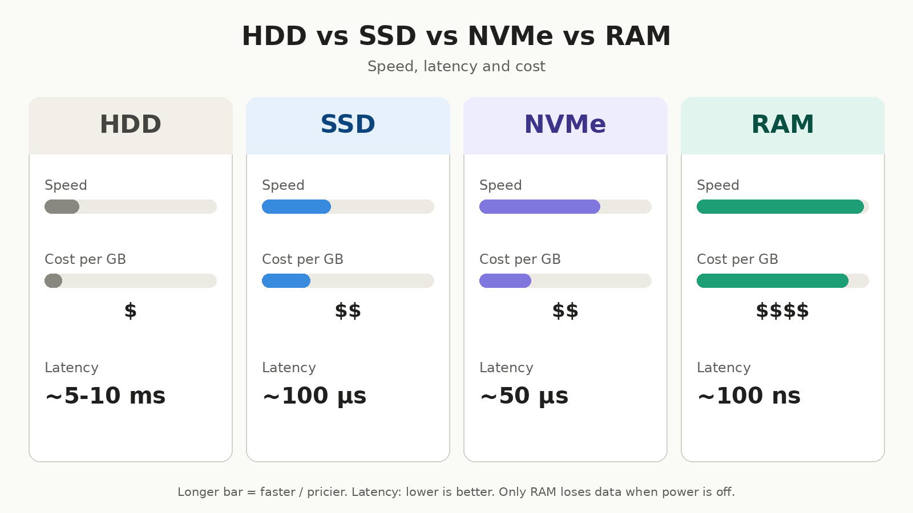

# Computer Architecture

> Understand how a computer executes instructions and where it stores data — from CPU registers to persistent disk.

## Topics

1. [CPU architecture](#cpu-architecture)
2. [Cache hierarchy (L1, L2, L3)](#cache-hierarchy-l1-l2-l3)
3. [Memory and disk](#memory-and-disk)
4. [Latency numbers every programmer should know](#latency-numbers-every-programmer-should-know)
5. [HDD vs SSD vs NVMe vs RAM](#hdd-vs-ssd-vs-nvme-vs-ram)

## Overview

| Component | Role |
|---|---|
| **CPU** | Executes instructions and performs calculations |
| **Cache** | Keeps frequently used instructions and data close to the CPU |
| **RAM** | Provides fast, temporary working memory |
| **Storage** | Keeps files and programs persistently |
| **Motherboard** | Connects components and carries communication between them |

---

## 1. CPU Architecture

The CPU is the primary processing unit of a computer. It executes instructions provided by programs.

### Main Components of a CPU

| Component | Responsibility |
|---|---|
| **Control Unit (CU)** | Coordinates instruction execution and controls CPU operations. |
| **Arithmetic Logic Unit (ALU)** | Performs arithmetic operations and logical comparisons. |
| **Registers** | Very small, extremely fast storage locations inside the CPU. |
| **Cache** | Stores frequently accessed instructions and data to reduce memory access latency. |
| **Clock** | Provides timing signals that coordinate CPU operations. |

### How Does the CPU Execute a Program?

The CPU generally follows an instruction cycle:

1. **Fetch:** Retrieves the next instruction from memory or cache.
2. **Decode:** Determines what the instruction means.
3. **Execute:** Performs the required operation.
4. **Store:** Writes the result to a register or memory when required.

This is commonly called the **Fetch–Decode–Execute cycle**.

### Example

Consider this code:

```c
int a = 10;
int b = 20;
int sum = a + b;
```

Conceptually, the CPU performs operations like:

1. Load the value `10` into a register.
2. Load the value `20` into another register.
3. Use the ALU to add the two values.
4. Store the result `30` in a register or memory.

The actual machine instructions depend on the processor architecture and compiler.

---

## 2. Cache Hierarchy (L1, L2, L3)

Cache is a small, high-speed memory located inside or very close to the CPU.

It stores copies of frequently accessed instructions and data so that the CPU can retrieve them faster than accessing RAM.

### Why Do We Need Cache?

The CPU can execute operations much faster than RAM can supply data.

If the CPU had to access RAM for every instruction and every piece of data, it would frequently have to wait.

Cache helps reduce this delay by keeping frequently used information closer to the CPU.

### Cache Hierarchy

<figure>
  
</figure>

Modern CPUs commonly use three levels of cache:

| Cache Level | Typical Size | Speed | Purpose |
|---|---|---|---|
| **L1** | 32–128 KB per core | Fastest | Stores frequently used instructions and data. |
| **L2** | 256 KB–2 MB per core | Slower than L1 | Provides additional storage for instructions and data. |
| **L3** | Several MB to tens of MB | Slower than L2 | Larger cache, commonly shared among CPU cores. |

*Sizes and access latencies vary depending on the CPU model and architecture.*

### L1 Cache

- Smallest and fastest cache.
- Usually located inside each CPU core.
- Commonly divided into two separate caches:

  - **L1 Instruction Cache (L1i):** Stores recently or frequently used machine instructions.
  - **L1 Data Cache (L1d):** Stores recently or frequently accessed data.

**Example:**

When a loop executes repeatedly, its machine instructions may remain in L1i. The variables being processed may be stored in L1d.

### L2 Cache

- Larger than L1 but slower.
- Commonly dedicated to an individual CPU core.
- Usually a unified cache, meaning it can store both instructions and data.
- Acts as the next level of storage when information is not found in L1.

### L3 Cache

- Larger than L2 but slower.
- Commonly shared among multiple CPU cores.
- Usually unified, storing both instructions and data.
- Helps reduce the need to access RAM, especially when multiple cores are working with shared data.

### Are L2 and L3 Also Divided into Instruction and Data Caches?

Usually, no.

| Cache | Instruction/Data Organization |
|---|---|
| L1 | Commonly split into L1i and L1d |
| L2 | Commonly unified |
| L3 | Commonly unified |

**Why is L1 split?**

The CPU may need to fetch the next instruction while simultaneously reading or writing data.

Separating L1 instruction and data caches allows these operations to happen independently, reducing competition for cache access.

L2 and L3 commonly use unified designs, allowing their capacity to be shared flexibly between instructions and data.

*Note: These are common design choices, not universal rules. Specific CPU architectures can differ.*

### How Does Cache Access Work?

The CPU generally looks for the required information in this order:

```text
              CPU requests data
                     |
                     v
                L1 Cache
                 /    \
              Hit      Miss
               |        |
               v        v
             CPU     L2 Cache
                      /    \
                   Hit      Miss
                    |        |
                    v        v
                  CPU     L3 Cache
                           /    \
                        Hit      Miss
                         |        |
                         v        v
                       CPU       RAM
```

- **Cache Hit:** Requested information is found in the cache.
- **Cache Miss:** Requested information is not found, so the CPU checks the next cache level or RAM.

The CPU can then use the retrieved information, and cache lines may be populated at the relevant cache levels.

### Example: Executing a Loop

Consider this C program:

```c
int sum = 0;

for (int i = 0; i < 1000; i++) {
    sum += i;
}
```

The compiler converts this code into machine instructions.

Conceptually, those instructions perform operations such as:

```asm
initialize sum
initialize i
compare i with 1000
add i to sum
increment i
jump back to loop
```

During repeated execution:

- **L1i:** May contain the machine instructions for the loop.
- **L1d:** May contain the variables and other data being accessed.
- **L2:** Can contain both instructions and data.
- **L3:** Can also contain both instructions and data.

Because the loop repeatedly executes the same instructions and accesses related data, cache can help reduce memory access delays.

### Important Cache Concepts

#### Cache Hit Ratio

The percentage of memory requests that are successfully served by the cache.

For example, if the CPU makes 100 memory requests and 90 are served by cache:

```text
Cache Hit Ratio = 90 / 100 = 90%
```

A higher hit ratio generally means fewer accesses to slower memory levels.

#### Temporal Locality

If a piece of data is accessed recently, it is likely to be accessed again soon.

**Example:** A variable used repeatedly inside a loop.

#### Spatial Locality

If a memory location is accessed, nearby memory locations are likely to be accessed soon.

**Example:** Iterating through an array sequentially.

#### Cache Line

Cache transfers data in fixed-size blocks called cache lines, rather than fetching just one individual variable.

A common cache-line size is 64 bytes, although this varies by architecture.

#### Cache Coherence

In multicore processors, multiple cores may have their own caches.

Cache coherence protocols help keep cached copies of shared data consistent when different cores read or modify that data.

---

### Frequently Asked Questions

#### Q1. What exactly are the instructions stored in L1 Instruction Cache?

They are machine instructions that the CPU executes.

For example, this code:

```c
sum = sum + i;
```

May be translated into machine instructions that load values, perform addition, and store the result.

When these instructions are executed repeatedly, they may remain in L1 Instruction Cache for faster fetching.

#### Q2. Does L1 store both instructions and data?

Yes, but commonly in two separate caches:

- L1i stores instructions.
- L1d stores data.

#### Q3. Do L2 and L3 also have instruction and data divisions?

Usually, no. They are commonly unified caches.

Both machine instructions and program data can be stored in L2 and L3.

#### Q4. Is cache the same as RAM?

No.

| Feature | Cache | RAM |
|---|---|---|
| Speed | Faster | Slower |
| Capacity | Much smaller | Much larger |
| Location | Inside or very close to CPU | Memory modules connected to the CPU |
| Purpose | Reduce memory access latency | Hold active programs and data |
| Cost per byte | Higher | Lower |

#### Q5. What happens if the data is not found in L1, L2, or L3?

The CPU must retrieve the required information from RAM (or another relevant memory source).

This takes significantly longer than a cache hit.

#### Q6. Is L3 shared by all CPU cores?

In many modern processors, L3 is shared among multiple cores. However, the exact organization depends on the processor architecture.

---

### Why Cache Matters in System Design

Cache hierarchy is a hardware-level concept, but the underlying principles are useful in software and system design.

- **Locality:** Access related data together instead of jumping randomly across memory.
- **Performance:** Sequential memory access can be more cache-friendly than random access.
- **Data structures:** Arrays often have better spatial locality than linked lists.
- **Concurrency:** Cache coherence and false sharing can affect multicore application performance.
- **Caching systems:** The same broad idea of keeping frequently accessed information closer to where it is needed appears in CPU caches, application caches, Redis, and CDNs.

> **Key takeaway:** Cache reduces the time the CPU spends waiting for instructions and data. L1 is the smallest and fastest, L2 provides additional capacity, and L3 provides an even larger cache that is commonly shared across cores.

---

## 3. Memory and Disk



Memory and storage help a computer hold the data and instructions needed to run programs.

### What is Memory?

Memory is the part of a computer where data and instructions are kept so the CPU can access and use them.

The CPU needs data and instructions while executing a program. Memory makes this data available for processing.

### What is Disk Storage?

Disk storage is used to store data permanently, even when the computer is switched off.

It stores:
- Operating systems
- Applications and programs
- Documents, images, and videos
- Databases and other files

When data is needed, it is read from the disk and loaded into RAM so the CPU can work with it.

### How Memory and Disk Work Together

When you open an application:

1. The application is stored on the SSD or HDD.
2. The operating system loads the required program data and instructions from disk into RAM.
3. The CPU accesses the data and executes the instructions.
4. While the application runs, it may modify data in RAM.
5. When you save your work, the changes are written to disk.

**Example:** When editing a document, the application and saved document are stored on disk. While you edit, the active data is held in RAM. Saving writes the updated document back to disk.

### Types of Memory and Storage

#### RAM (Random Access Memory)

- Temporary working memory used by running programs.
- Holds data and instructions currently needed by the CPU.
- Fast to access.
- Volatile: data is lost when the computer is switched off.

#### SSD (Solid State Drive)

- Permanent storage that uses flash memory.
- Stores the operating system, applications, and files.
- Has no moving mechanical parts.
- Faster than a traditional HDD.
- Non-volatile: data remains when the computer is switched off.

#### HDD (Hard Disk Drive)

- Permanent storage that uses rotating magnetic disks.
- Data is stored magnetically on the disk's surface.
- Uses moving mechanical parts to read and write data.
- Generally slower than an SSD.
- Non-volatile: data remains when the computer is switched off.

### How Disk Read and Write Work

- **Read:** The computer retrieves existing data from the disk and makes it available in RAM.
- **Write:** The computer saves new or modified data to the disk.

For example:
- Opening a photo involves reading it from disk.
- Saving an edited photo involves writing the updated file to disk.

### Memory vs Storage

| Feature | RAM | SSD | HDD |
|---|---|---|---|
| Purpose | Active working data | Long-term storage | Long-term storage |
| Technology | Semiconductor memory | Flash memory | Magnetic disks |
| Speed | Very fast | Fast | Slower |
| Volatility | Volatile | Non-volatile | Non-volatile |
| Data after shutdown | Lost | Retained | Retained |
| Typical capacity | Smaller | Larger | Larger |

### Memory Hierarchy

From fastest to slowest:

1. CPU Registers
2. CPU Cache (L1, L2, L3)
3. RAM
4. SSD
5. HDD

Generally, faster memory is more expensive per unit of capacity.

> **Key takeaway:** Memory holds active data for the CPU, while disk storage retains data long-term. RAM is volatile; SSD and HDD storage are non-volatile.

---

## 4. Latency Numbers Every Programmer Should Know

### What is Latency?

Latency is the time taken to complete an operation or receive a response.

For example:
- Reading data from RAM takes very little time.
- Reading data from an SSD takes longer.
- Fetching data from a remote server usually takes even longer.

### Why Should Programmers Know Latency?

Not all operations take the same amount of time.

Understanding latency helps programmers:
- Identify slow operations.
- Improve application performance.
- Reduce unnecessary database and network calls.
- Design faster and more responsive systems.

### Common Latency Numbers

The following are approximate reference values. Actual times depend on hardware, network conditions, and system load.

| Operation | Approximate Latency |
|---|---:|
| CPU register access | Less than 1 ns |
| L1 cache access | 1 ns |
| L2 cache access | 4 ns |
| L3 cache access | 10 ns |
| RAM access | 100 ns |
| SSD random read | 100 µs |
| HDD seek | 10 ms |
| Network request within a data center | 0.5 ms |
| Network round trip across continents | 100–200 ms |

### Understanding the Units

Latency is measured in units of time:

- **ns (Nanosecond):** One billionth of a second.
- **µs (Microsecond):** One millionth of a second.
- **ms (Millisecond):** One thousandth of a second.
- **s (Second):** One second.

Relationship:

- 1 ms = 1,000 µs
- 1 µs = 1,000 ns
- 1 second = 1,000 ms

### Simple Example

Imagine a user opens a web page:

1. The application reads data from RAM.
2. It fetches additional data from a database.
3. It communicates with another service over the network.
4. It sends the response to the user.

Each operation adds latency to the overall response time.

If one operation is significantly slower than the others, it can become a performance bottleneck.

### Key Takeaways

- Latency is the time taken to perform an operation.
- CPU cache and RAM are much faster than disk storage.
- SSDs are generally faster than HDDs.
- Network communication can introduce significant delays.
- Understanding latency helps identify performance bottlenecks.

---

## 5. HDD vs SSD vs NVMe vs RAM



### HDD (Hard Disk Drive)

- Stores data magnetically.
- Has moving parts.
- Slow but cheaper.
- Keeps data after shutdown.

### SSD (Solid State Drive)

- Stores data using flash memory.
- Has no moving parts.
- Faster than HDD.
- Keeps data after shutdown.

### NVMe SSD

- A type of SSD that uses the PCIe connection.
- Much faster than a SATA SSD.
- Common in modern computers.
- Keeps data after shutdown.

### RAM (Random Access Memory)

- Temporary working memory.
- Holds data used by running programs.
- Very fast.
- Loses data when power is off.

### Quick Comparison

| Type | Technology | Typical role | Relative speed | Cost per GB | Data after shutdown |
|---|---|---|---|---|---|
| **HDD** | Magnetic disks | Bulk storage, backups | Slowest | Lowest | Retained |
| **SATA SSD** | Flash memory over SATA | General storage | Fast | Medium | Retained |
| **NVMe SSD** | Flash memory over PCIe | Fast storage and workloads | Very fast | Higher | Retained |
| **RAM** | Semiconductor memory | Active working data | Fastest | Highest | Lost |

### What is PCIe?

PCIe (Peripheral Component Interconnect Express) is a high-speed connection used to connect hardware components to a computer's motherboard.

Examples:
- NVMe SSDs use PCIe.
- Graphics cards (GPU) use PCIe.

### Simple Analogy

Imagine working at a desk:

- HDD / SSD / NVMe = Cupboard where files are stored.
- RAM = Desk where files are kept while working.
- CPU = Person doing the work.

### Key Takeaways

- HDD = Slower and cheaper storage.
- SSD = Faster storage using flash memory.
- NVMe = SSD that uses PCIe for faster data transfer.
- RAM = Very fast temporary working memory.
- PCIe = High-speed connection for computer components.
