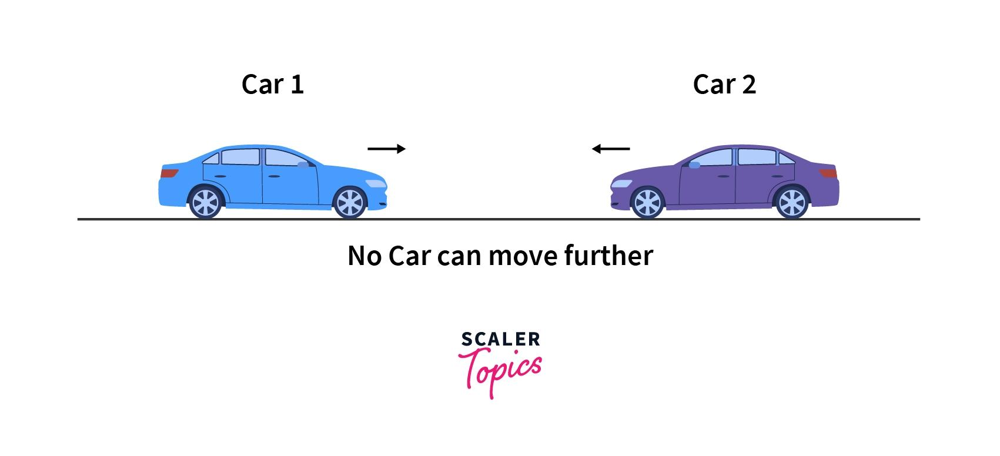

# 3. Concurrency Fundamentals

## 3.1 Locks

### What is a Lock?

A **Lock** is a synchronization mechanism used to control access to shared resources and prevent unwanted simultaneous access by multiple threads.

When a thread acquires a lock, other threads must follow the locking rules before accessing the protected resource.

### Real-Time Example: ATM Machine

Imagine an ATM machine used by multiple people:

1. Person A starts using the ATM.
2. Person B waits until Person A finishes.
3. Person A finishes and releases the ATM.
4. Person B can now use the ATM.

<!--  -->

### Why are Locks Needed?

- Prevent unwanted simultaneous access to shared data.
- Protect critical sections of code.
- Maintain data consistency.
- Prevent interference between threads.

### What is a Critical Section?

A **Critical Section** is a part of a program where shared resources or data are accessed or modified.

Locks help control which threads can enter a critical section.

**Remember:** Lock = Controls access to a shared resource.

---

### Types of Locks

There are different types of locks used in concurrent programming. Each type follows different rules for controlling access to shared resources.

#### 1. Mutex (Mutual Exclusion)

A **Mutex** is a specific type of lock that allows only one thread to access a protected resource at a time.

The thread that acquires the Mutex is responsible for releasing it.

**Example: ATM Machine**

1. Person A gets access to the ATM.
2. Person B waits.
3. Person A finishes and releases the access.
4. Person B gets access.

**Remember:** Mutex = Only one owning thread can access the protected resource at a time.

#### 2. Spinlock

A **Spinlock** is a type of lock where a thread repeatedly checks whether the lock is available instead of sleeping while waiting.

This repeated checking is called **Busy Waiting**.

**Example: ATM Machine**

1. Person A is using the ATM.
2. Person B waits outside.
3. Person B repeatedly checks whether the ATM is available.
4. As soon as Person A leaves, Person B acquires the lock.

**Remember:** Spinlock = Keep checking until the lock becomes available.

#### 3. Read-Write Lock

A **Read-Write Lock** allows multiple threads to read shared data simultaneously, but allows only one thread to write at a time.

**Rules:**

- Multiple threads can read data simultaneously.
- Only one thread can write data at a time.
- Reading and writing cannot happen simultaneously under the lock.

**Example: Shared Document**

1. Multiple people can view a document at the same time.
2. Only one person can edit the document.
3. While someone is editing, other users must wait to access it under the lock.

**Remember:** Read-Write Lock = Multiple readers, but only one writer.

#### 4. Reentrant Lock

A **Reentrant Lock** allows the same thread to acquire the same lock multiple times without getting blocked by itself.

The thread must release the lock the corresponding number of times before another thread can acquire it.

**Example: Room Access**

1. Person A acquires a room key.
2. Person A enters another section that requires the same lock.
3. The same person can acquire the lock again without blocking itself.
4. Person A releases the lock the required number of times.

**Remember:** Reentrant Lock = The same thread can acquire the same lock repeatedly.

---

### Quick Comparison of Lock Types

| Lock Type | Main Purpose |
|---|---|
| Mutex | One thread at a time |
| Spinlock | Keep checking until available |
| Read-Write Lock | Multiple readers, one writer |
| Reentrant Lock | Same thread can acquire repeatedly |

---

### Important Points to Remember

1. **Lock:** Controls access to a shared resource.
2. **Critical Section:** Part of a program where shared data is accessed or modified.
3. **Mutex:** Allows one owning thread at a time.
4. **Spinlock:** Repeatedly checks until the lock becomes available.
5. **Read-Write Lock:** Allows multiple readers but only one writer.
6. **Reentrant Lock:** Allows the same thread to acquire the same lock multiple times.

**Remember:**

- Lock = General synchronization mechanism.
- Mutex = A specific type of lock.
- Spinlock = Uses busy-waiting.
- Read-Write Lock = Multiple readers, one writer.
- Reentrant Lock = Same thread can acquire repeatedly.

**Every Mutex is a lock, but not every lock is a Mutex.**

---

## 3.2 Semaphores

### What is a Semaphore?

A **Semaphore** is a synchronization mechanism used to control how many threads can access a shared resource at the same time.

It helps prevent conflicts when multiple threads try to access the same resource simultaneously.

### Real-Time Example: Parking Lot 🚗

Imagine a parking lot with only **3 parking spaces**.

- Only 3 cars can park at a time.
- If all 3 spaces are occupied, the next car must wait.
- When one car leaves, another car can enter.

Similarly, in programming:

| Parking Lot | Programming Concept |
|---|---|
| Car | Thread |
| Parking space | Permit |
| Enter parking | `acquire()` |
| Leave parking | `release()` |

**In simple words:** A semaphore controls the number of threads allowed to access a shared resource simultaneously.

---

### Types of Semaphores

There are **2 main types of semaphores**:

#### 1. Binary Semaphore

A **Binary Semaphore** has only 0 or 1 permit.

- Allows only one thread at a time when used to control access to a resource.
- Its value can be either `0` or `1`.
- Example: A parking lot with only 1 parking space.

#### 2. Counting Semaphore

A **Counting Semaphore** has multiple permits.

- Allows multiple threads to access a shared resource simultaneously.
- Its permit count can be greater than 1.
- Example: A parking lot with 5 parking spaces allows 5 cars at a time.

---

### Difference Between Binary and Counting Semaphores

| Feature | Binary Semaphore | Counting Semaphore |
|---|---|---|
| Number of permits | 0 or 1 | Multiple permits |
| Access | One thread at a time | Multiple threads at a time |
| Example | Parking lot with 1 space | Parking lot with 5 spaces |
| Main purpose | Controls single-resource access | Controls access to multiple resource instances |

---

### Important Semaphore Operations

| Operation | Meaning |
|---|---|
| `acquire()` | Requests a permit to access the resource. If no permit is available, the thread waits. |
| `release()` | Returns a permit after finishing the resource usage. |

---

### Quick Revision – Remember This!

- **Semaphore:** Controls how many threads can access a shared resource simultaneously.
- **Binary Semaphore:** Has only 0 or 1 permit.
- **Counting Semaphore:** Has multiple permits.
- **`acquire()`:** Takes a permit.
- **`release()`:** Returns a permit.

---

## 3.3 Deadlock

### What is Deadlock?

A **Deadlock** happens when two or more threads wait for each other to release resources, and none of them can continue.

### Real-Time Example: Two Cars on a Narrow Road 🚗

Imagine two cars on a narrow road facing each other.

- Car A waits for Car B to move.
- Car B waits for Car A to move.
- Neither car moves.

This situation is called a **Deadlock**.

### Programming Example

- Thread 1 holds Resource A and waits for Resource B.
- Thread 2 holds Resource B and waits for Resource A.
- Both threads get stuck because neither can release its resource.

### 4 Conditions of Deadlock

- **Mutual Exclusion:** Only one thread can use a resource at a time.
- **Hold and Wait:** A thread holds one resource and waits for another resource.
- **No Preemption:** Resources cannot be forcibly taken away from a thread.
- **Circular Wait:** Threads wait for each other in a circular chain.

### How to Prevent Deadlocks?

- **Acquire locks in the same order:** Ensure all threads acquire resources in a consistent order.
- **Avoid unnecessary locks:** Use only the locks required.
- **Use lock timeouts:** Set a maximum waiting time when acquiring locks.

---
## 3.4 Race Condition

### What is a Race Condition?

A **Race Condition** happens when two or more threads access and modify the same shared data at the same time, and the final result depends on which thread executes first.

### Real-Time Example 🏦

Imagine two people withdrawing money from the same bank account.

- Account balance = ₹1,000.
- Person A withdraws ₹700.
- Person B withdraws ₹500.
- Both transactions happen simultaneously.
- Both may read the original balance of ₹1,000.

This can cause an incorrect balance or inconsistent transactions.

---

## 3.5 Atomic Operations

### What are Atomic Operations?

An **Atomic Operation** is an operation that executes completely as a single, indivisible step.

**In simple words:**

> An operation either happens completely or doesn't happen at all. No other thread can interrupt it midway.

### Real-Time Example 🏦

Imagine transferring ₹500 from Account A to Account B.

- ₹500 is deducted from Account A.
- ₹500 is added to Account B.
- The operation should complete safely without interference.

---