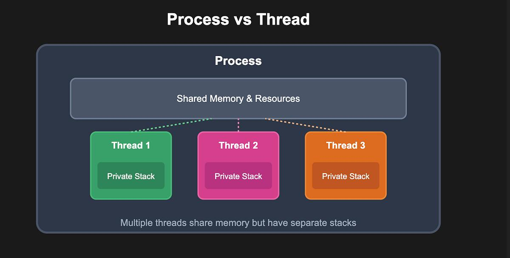
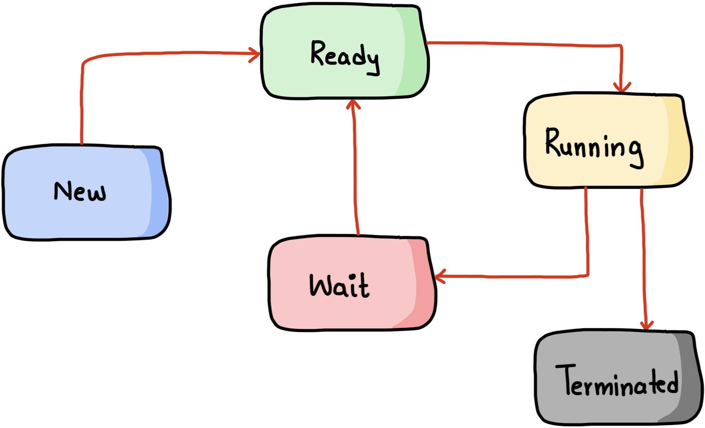

# 3. Processes and Threads

## 3.1 Processes and Threads

### What is a Process?

A **Process** is a program that is currently running in the operating system.

**Example:**
- You open Google Chrome → Chrome becomes a process.
- You open VS Code → VS Code becomes another process.
- You open Spotify → Spotify becomes another process.

Each process has its own memory space and system resources.

### What is a Thread?

A **Thread** is the smallest unit of execution within a process.

A process can contain multiple threads that perform different tasks.

**Example:**

When you use Google Chrome, different threads can handle activities such as:

- Loading a webpage.
- Downloading a file.
- Playing a video.
- Handling user interactions.

These activities can run concurrently using multiple threads.

### Process vs Thread

| Process | Thread |
|---|---|
| A running program | A unit of execution inside a process |
| Has its own memory space | Shares process memory with other threads |
| Requires more resources | Generally requires fewer resources |
| Communication is relatively expensive | Communication is relatively easier |

**Remember:**
- Process = Running Application.
- Thread = Worker inside a Process.

---

## 3.2 Context Switching

### What is Context Switching?

**Context Switching** is the process in which the CPU switches from one process or thread to another.

Before switching, the operating system saves the current task's execution state and restores the state of the next task.

This allows multiple tasks to share CPU time.

### Example

Imagine you are using multiple applications:

1. CPU executes Chrome.
2. CPU switches to VS Code.
3. CPU switches to Spotify.
4. CPU switches back to Chrome.

This switching between tasks is called **Context Switching**.

### What is Saved During Context Switching?

The operating system saves information such as:

- Program Counter (PC).
- CPU Registers.
- Process or Thread State.
- Other execution-related information.

### Why is Context Switching Needed?

- Allows multitasking.
- Helps multiple processes share the CPU.
- Improves CPU utilization.
- Allows the operating system to manage multiple tasks.

**Remember:** Context Switching = Saving one task's state and switching to another task.

---

## 3.3 CPU Scheduling

### What is CPU Scheduling?

**CPU Scheduling** is the process of selecting which process or thread should get the CPU next.

Since multiple processes may be ready to execute, the operating system needs a way to decide which one gets CPU time.

### Who Performs CPU Scheduling?

The **CPU Scheduler** (also called the Short-Term Scheduler) selects a process from the ready queue and allocates the CPU to it.

### Example

Imagine a teacher managing students:

- Multiple students want to answer.
- The teacher decides who gets the next turn.
- Similarly, the CPU Scheduler decides which process gets CPU time.

### Common CPU Scheduling Algorithms

| Algorithm | Description |
|---|---|
| FCFS | First Come, First Served |
| SJF | Shortest Job First |
| Priority Scheduling | Highest-priority process executes first |
| Round Robin | Each process gets a fixed time slice |

### Why is CPU Scheduling Important?

- Improves CPU utilization.
- Reduces waiting time.
- Improves system responsiveness.
- Helps manage multiple processes efficiently.

**Remember:** CPU Scheduling = Deciding which process gets CPU time next.

---

## 3.4 Process and Thread Lifecycle

### What is a Process Lifecycle?

A **Process Lifecycle** describes the different states a process goes through from creation to completion.

### Process Lifecycle States

| State | Meaning |
|---|---|
| New | Process is being created. |
| Ready | Process is waiting for CPU time. |
| Running | Process is currently using the CPU. |
| Waiting / Blocked | Process is waiting for I/O or an event. |
| Terminated | Process has finished execution. |

### Process State Transitions

A process moves between states during execution:

1. **New → Ready:** Process is created and admitted into the ready queue.
2. **Ready → Running:** CPU Scheduler selects the process.
3. **Running → Ready:** Process is interrupted or its time slice expires.
4. **Running → Waiting:** Process waits for an I/O operation or event.
5. **Waiting → Ready:** Required I/O operation or event is completed.
6. **Running → Terminated:** Process completes execution.

### What is a Thread Lifecycle?

A thread also goes through different execution states during its lifetime.

Common conceptual states include:

- **New:** Thread is created.
- **Ready:** Thread is ready to execute.
- **Running:** Thread is currently executing.
- **Blocked / Waiting:** Thread is waiting for an event or resource.
- **Terminated:** Thread has completed execution.

> Note: Actual thread states and transitions depend on the operating system and threading model.

### Process vs Thread Lifecycle

| Process Lifecycle | Thread Lifecycle |
|---|---|
| Describes the states of a process | Describes the states of a thread |
| Process has its own resources | Threads share process resources |
| Process can contain multiple threads | A thread belongs to one process |

**Remember:** Lifecycle = The journey of a process or thread from creation to completion.

---

## Quick Revision – Remember These 5 Things

1. **Process:** A program that is currently running.
2. **Thread:** A unit of execution inside a process.
3. **Context Switching:** Saving one task's state and switching to another.
4. **CPU Scheduling:** Selecting which process or thread gets CPU time.
5. **Lifecycle:** The different states a process or thread goes through.

---

## Important One-Line Definitions

| Topic | Definition |
|---|---|
| Process | A program in execution. |
| Thread | The smallest unit of execution within a process. |
| Context Switching | Switching the CPU from one task to another. |
| CPU Scheduling | Selecting the next process or thread for CPU execution. |
| Process Lifecycle | Different states a process goes through during its lifetime. |
| Ready Queue | A queue of processes waiting for CPU allocation. |
| Scheduler | An OS component that selects processes for execution. |

